<div align="center">
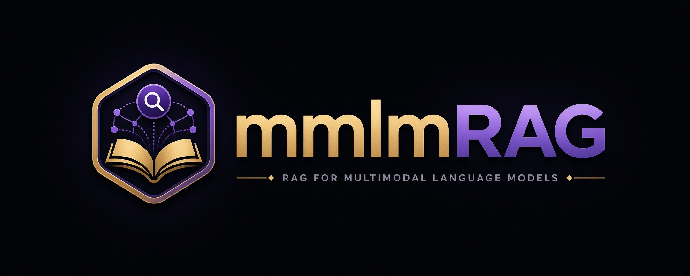

mmlmRAG（`ragcli`）是本機混合語言檢索增強生成命令列工具。`rag` 命令讀取這部裝置上的文件，經 [Ollama](https://ollama.com) 的本機模型做嵌入，並依該語料回答問題。正文同向量留在 `data/` 下的 SQLite 資料庫同 Chroma 索引。

[](https://github.com/mark1688288/mmlmRAG)
[](https://www.python.org/downloads/)
[](#前置需求)
[](https://ollama.com)
[](LICENSE)

[English](README.md)

</div>

## 前置需求

- macOS。OCR 經 Vision 框架。可用記憶體檢查使用 `vm_stat`。
- Python 3.13 或更新版本。
- Ollama 監聽迴路地址。`rag.toml` 的預設是 `http://127.0.0.1:11434`。允許的主機是 `127.0.0.1`、`localhost` 同 `::1`。
- 載入的生成模型要有足夠的可用記憶體。預設的 `qwen3.5:9b` 需要 9 GiB。後備的 `qwen3.5:4b` 需要 6 GiB。
- 入庫、提問或重建向量之前，至少要有 2 GiB 可用磁碟空間。

`rag models pull` 經本機 Ollama 常駐程式下載這些模型：

| 角色 | 模型 |
| --- | --- |
| 嵌入 | `qwen3-embedding:0.6b`（1024 維） |
| 回答 | `qwen3.5:9b` |
| 記憶體不足時的後備 | `qwen3.5:4b` |

## 依賴

`pyproject.toml` 宣告的執行期依賴：

| 套件 | 要求 | 角色 |
| --- | --- | --- |
| `chromadb` | `==1.5.9` | 持久向量索引 |
| `httpx` | 未釘選 | 給 Ollama 用的迴路 HTTP 客戶端 |
| `pymupdf` | 未釘選 | PDF 解析器 |
| `python-docx` | 未釘選 | Word 文件 |
| `python-pptx` | 未釘選 | PowerPoint 文件 |
| `ocrmac` | 未釘選 | macOS Vision OCR |
| `pillow` | 未釘選 | 圖像解碼 |
| `pillow-heif` | 未釘選 | HEIC 同 HEIF |
| `charset-normalizer` | 未釘選 | 文字編碼偵測 |

開發用的額外依賴是 `pytest`。`chromadb` 維持在 1.5.9。改動這個釘選是刻意的升級。

SQLite 來自 Python 標準程式庫，屬於公有領域。

接受入庫的檔案是 `.pdf`、`.docx`、`.pptx`、`.txt`、`.md`、`.png`、`.jpg`、`.jpeg`、`.webp`、`.tif`、`.tiff`、`.gif`、`.bmp`、`.heic` 同 `.heif`。每次 `rag ingest` 只接受一個普通檔案。

## 安裝

### Homebrew

```bash
brew install mark1688288/mmlmrag/mmlmrag
```

這會從 [homebrew-mmlmrag](https://github.com/mark1688288/homebrew-mmlmrag) tap 安裝 `rag` 命令。公式依賴 macOS 同 `python@3.13`，並釘選 `v0.1.2` 標籤的封存檔。它的 Python 資源是該標籤的 Apple Silicon wheel。第一次執行 `rag` 會建立 `~/.mmlmrag`，包括一個私有環境，以及在尚未存在時建立 `rag.toml`。工作目錄或其父目錄若有 `rag.toml`，會改用那一份。否則 `rag` 使用 `~/.mmlmrag/rag.toml`。

先安裝 Ollama，再拉取預設模型。

```bash
brew install ollama
brew services start ollama
rag models pull
```

## 用法

```bash
rag ingest ./notes.pdf
rag ask "What does the note say about the budget?"
rag status
rag config show
```

| 指令 | 用途 |
| --- | --- |
| `rag ingest FILE` | 解析、OCR、描述圖像，並嵌入一個檔案 |
| `rag ask QUESTION` | 依作用中集合回答 |
| `rag reembed` | 為另一個嵌入模型或寬度重建向量 |
| `rag use --collection NAME` | 切換作用中集合 |
| `rag delete --path PATH` 或 `--doc-id ID` | 刪除一份文件 |
| `rag status` | 顯示本機語料，以及 Ollama 能否回答 |
| `rag models pull` | 拉取已設定的模型 |
| `rag models unload` | 卸載 Ollama 已載入的模型 |
| `rag config show` | 印出解析後的設定 |

`--config` 指定一個 TOML 檔。預設由工作目錄向上尋找 `rag.toml`。`--data-dir` 覆蓋 `paths.data_dir`。`--verbose` 打開除錯日誌。`--lock-timeout` 是等待 Ollama 鎖的秒數。`0` 表示不等待。

`rag ingest` 接受 `--force`、`--resume`、`--no-ocr`、`--no-vision`、`--no-embed`、`--strict`、`--max-pages` 同 `--max-bytes`。`rag ask` 接受 `--k`（1 到 8）、`--model`、`--no-fallback`、`--show-chunks` 同 `--json`。

`--lang` 選擇介面語言，`en` 或 `zh`。`en` 是英文，也是預設。`zh` 是繁體中文。這個旗標覆蓋 `rag.toml` 的 `[ui] language`。兩者都沒有時，介面是英文。ragcli 不讀 `LANG`、`LC_ALL`，也不讀 macOS 偏好語言。值必須恰好是 `en` 或 `zh`。`[ocr] languages` 選擇 Vision 辨識語言，不跟介面語言連動。用法列、區段標題、說明動作那一句，以及 argparse 的錯誤外框，跟 `--lang` 與 `ui.language`。

```toml
[ui]
language = "zh"
```

## 安全

文件正文、頁面圖像同嵌入留在這部 Mac。`rag.toml` 沒有秘密欄位。

- **只走迴路。** Ollama URL 必須是 `127.0.0.1`、`localhost` 或 `::1` 上的 `http` 或 `https`。帳號、密碼、路徑同查詢字串都會被拒絕。HTTP 客戶端遇到重新導向就停止，而且忽略代理環境變數。拉取模型使用 Ollama 的 HTTP API。ragcli 不會啟動 shell 去執行 `ollama` 二進位檔。
- **權重同文件。** `rag models pull` 要求本機常駐程式下載模型權重。該傳輸屬於 Ollama。入庫同提問只把提示送到該迴路常駐程式。
- **遙測。** Chroma 客戶端在開啟時關閉匿名遙測。該開關若打開，ragcli 拒絕開啟 Chroma。
- **檔案。** ragcli 建立的資料目錄模式是 `0700`。SQLite 資料庫同其附帶檔的模式是 `0600`。已經存在的目錄保持原來的模式。資料目錄同入庫路徑必須是真實路徑，不能是符號連結。`data/` 列在 gitignore。
- **日誌。** 除錯日誌不印文件正文。
- **不受信任的輸入。** PDF 用 PyMuPDF 解析，圖像用 Pillow。兩者都應視為解析不受信任位元組的程式。預設會停下超過 200 MiB 的檔案、超過 500 頁的文件、超過 300 張圖像的檔案，以及超過 2,000 萬像素的圖像。有密碼保護的 PDF 會被拒絕，而且不會提示輸入密碼。檔頭已超過像素上限的圖像不會解碼。
- **程序。** 載入生成模型之前，ragcli 讀取 `/usr/bin/vm_stat`，需要頁面大小時再讀 `/usr/sbin/sysctl -n hw.pagesize`。這兩組引數是僅有的子程序。
- **授權。** mmlmRAG 是 AGPL-3.0-only。再散布本程式，或透過網路提供修改版，都必須依該授權提供對應原始碼。見[授權](#授權)。
- **回報。** 尚未修復的漏洞請依 [SECURITY.md](SECURITY.md) 回報。該政策使用 GitHub 的非公開漏洞回報，因此回報不會出現在公開議題清單。

## 示範
### 拉取模型

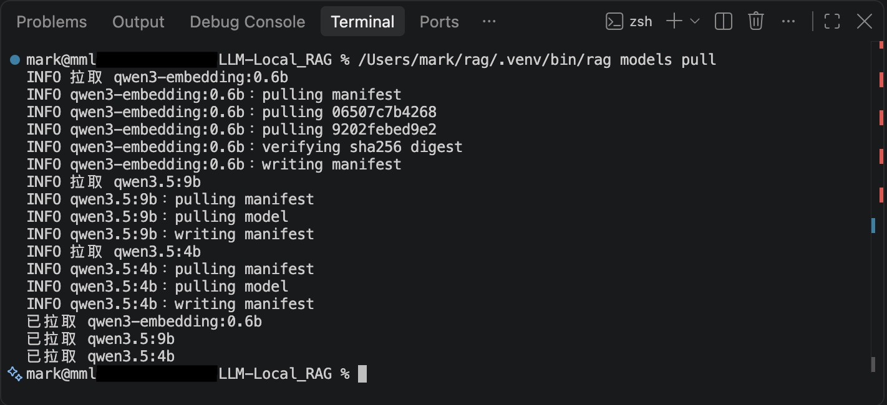

### 入庫

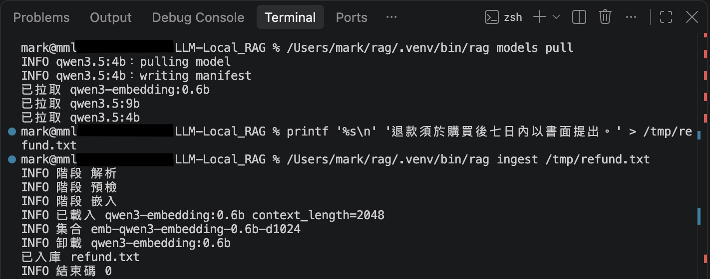

### 提問

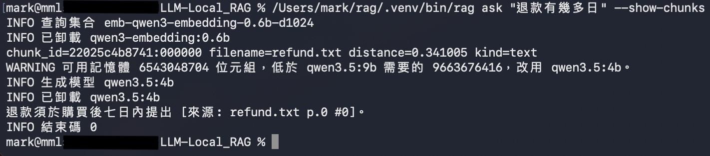

### 即時示範
#### PDF 轉文字
來源：empf.org.hk - Mandatory Provident Fund Schemes (Specification of Dates for Purposes of Section 19M(2)(a)) (Amendment) Notice 2026

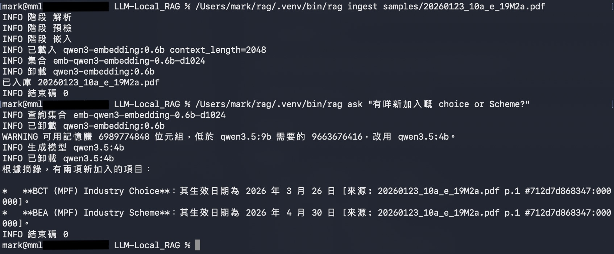

來源：hb.gov.hk/eng/policy/housing/policy/light_public_housing/pamphlet.html - "Light Public Housing — Full Rollout"

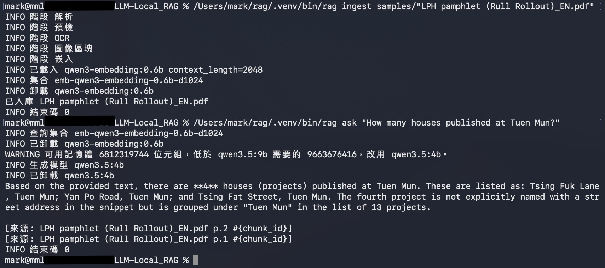

#### 長文件

source: www.gov.hk/en/residents/government/policy/government_reports/reports_index.htm - 就大埔宏福苑火災成立的獨立委員會報告 (第一冊 及 第二冊)

IC-Report-Volume1_tc.pdf, 發佈日期: 29-10-2026, 檔案大小: 26.9 MB, 總頁數: 477, SHA-256: b485d41d886320c9131003b13981142d73c0d2324a5c574a38c17b85af6e3a49
<br />
IC-Report-Volume2_tc.pdf, 發佈日期: 29-10-2026, 檔案大小: 45.9 MB, 總頁數: 584, SHA-256: 5c2d253b347ed43115b0a654d16b136b39a41d7dde27ee38c6c64d0e3f4abc9c

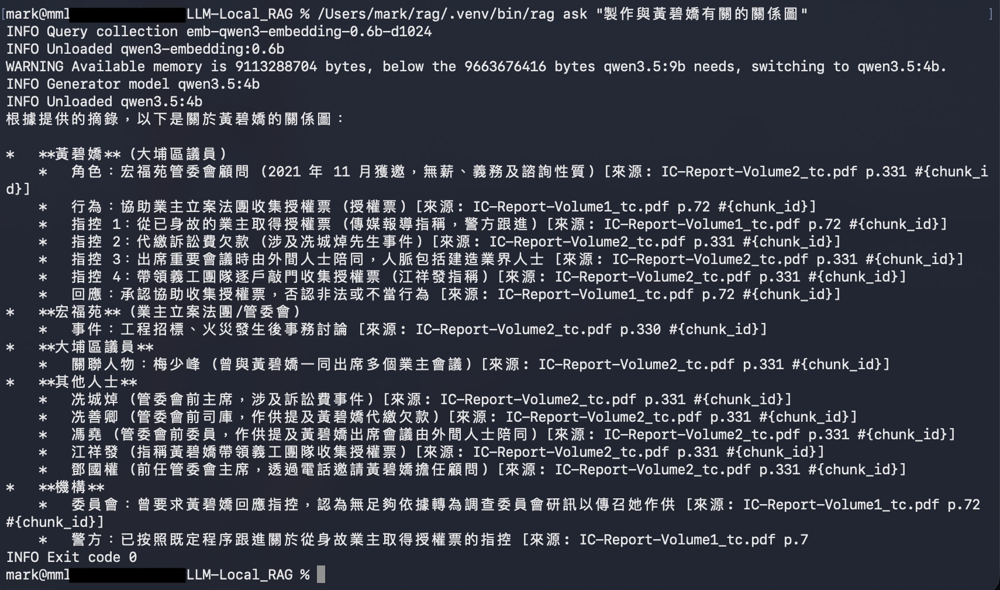

```bash
INFO Query collection emb-qwen3-embedding-0.6b-d1024
INFO Unloaded qwen3-embedding:0.6b
WARNING Available memory is 9113288704 bytes, below the 9663676416 bytes qwen3.5:9b needs, switching to qwen3.5:4b.
INFO Generator model qwen3.5:4b
INFO Unloaded qwen3.5:4b
根據提供的摘錄，以下是關於黃碧嬌的關係圖：

*   **黃碧嬌** (大埔區議員)
    *   角色：宏福苑管委會顧問 (2021 年 11 月獲邀，無薪、義務及諮詢性質) [來源: IC-Report-Volume2_tc.pdf p.331 #{chunk_id}]
    *   行為：協助業主立案法團收集授權票 (授權票) [來源: IC-Report-Volume1_tc.pdf p.72 #{chunk_id}]
    *   指控 1：從已身故的業主取得授權票 (傳媒報導指稱，警方跟進) [來源: IC-Report-Volume1_tc.pdf p.72 #{chunk_id}]
    *   指控 2：代繳訴訟費欠款 (涉及冼城焯先生事件) [來源: IC-Report-Volume2_tc.pdf p.331 #{chunk_id}]
    *   指控 3：出席重要會議時由外間人士陪同，人脈包括建造業界人士 [來源: IC-Report-Volume2_tc.pdf p.331 #{chunk_id}]
    *   指控 4：帶領義工團隊逐戶敲門收集授權票 (江祥發指稱) [來源: IC-Report-Volume2_tc.pdf p.331 #{chunk_id}]
    *   回應：承認協助收集授權票，否認非法或不當行為 [來源: IC-Report-Volume1_tc.pdf p.72 #{chunk_id}]
*   **宏福苑** (業主立案法團/管委會)
    *   事件：工程招標、火災發生後事務討論 [來源: IC-Report-Volume2_tc.pdf p.330 #{chunk_id}]
*   **大埔區議員**
    *   關聯人物：梅少峰 (曾與黃碧嬌一同出席多個業主會議) [來源: IC-Report-Volume2_tc.pdf p.331 #{chunk_id}]
*   **其他人士**
    *   冼城焯 (管委會前主席，涉及訴訟費事件) [來源: IC-Report-Volume2_tc.pdf p.331 #{chunk_id}]
    *   冼善卿 (管委會前司庫，作供提及黃碧嬌代繳欠款) [來源: IC-Report-Volume2_tc.pdf p.331 #{chunk_id}]
    *   馮堯 (管委會前委員，作供提及黃碧嬌出席會議由外間人士陪同) [來源: IC-Report-Volume2_tc.pdf p.331 #{chunk_id}]
    *   江祥發 (指稱黃碧嬌帶領義工團隊收集授權票) [來源: IC-Report-Volume2_tc.pdf p.331 #{chunk_id}]
    *   鄧國權 (前任管委會主席，透過電話邀請黃碧嬌擔任顧問) [來源: IC-Report-Volume2_tc.pdf p.331 #{chunk_id}]
*   **機構**
    *   委員會：曾要求黃碧嬌回應指控，認為無足夠依據轉為調查委員會研訊以傳召她作供 [來源: IC-Report-Volume1_tc.pdf p.72 #{chunk_id}]
    *   警方：已按照既定程序跟進關於從身故業主取得授權票的指控 [來源: IC-Report-Volume1_tc.pdf p.7
INFO Exit code 0
```

#### OCR 圖像轉文字

來源：[samples-live/demo.gif](samples-live/demo.gif)

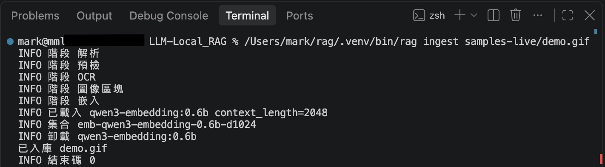
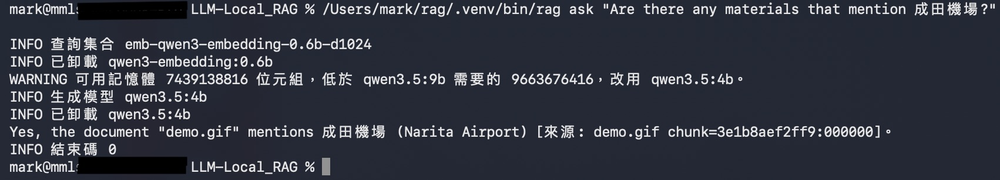

#### OCR-Vision 圖像尋找物件

來源：[samples-live/demo.jpeg](samples-live/demo.jpeg)

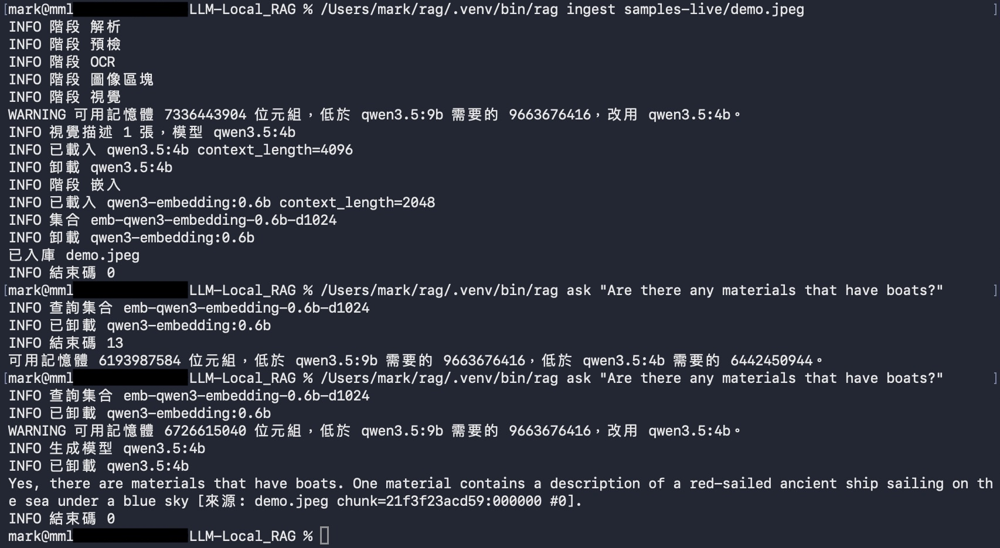

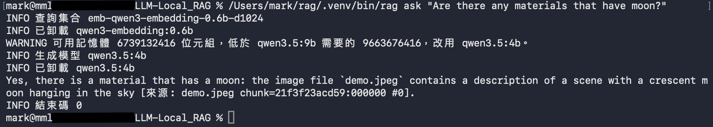

#### 查詢語料
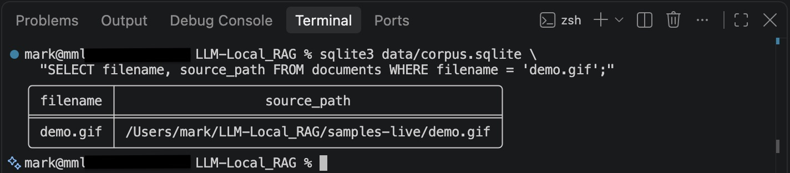

## 授權

Copyright (c) 2026 mark1688288.

mmlmRAG 是自由軟體。你可以依自由軟體基金會發布的 GNU Affero General Public License（僅第 3 版）再散布同修改它。全文在 [LICENSE](LICENSE)。

任何散布本程式的人，或透過網路讓使用者執行修改版的人，都必須依 AGPL-3.0-only 提供對應原始碼。入庫到 `data/` 的文件不是本程式的一部分。

PyMuPDF 可以依同樣的 AGPL-3.0 條款提供，也可以依 Artifex 商業授權提供。pillow-heif 的二進位 wheel 捆進了以 GPL version 2 或任何後續版本授權的 x265，因此合併後的散布仍是 AGPL-3.0-only。見[致謝](#致謝)。

## 致謝

以下是授權要求附上著作權或署名聲明的直接執行期程式庫。本檔底部的註腳就是該聲明。每個已安裝的套件也帶有完整的授權本文。

- [Chroma](https://github.com/chroma-core/chroma)[^chroma] 儲存向量。
- [HTTPX](https://github.com/encode/httpx)[^httpx] 跟 Ollama 通訊。
- [PyMuPDF](https://github.com/pymupdf/PyMuPDF)[^pymupdf] 讀取 PDF。
- [python-docx](https://github.com/python-openxml/python-docx)[^docx] 讀取 Word 文件。
- [python-pptx](https://github.com/scanny/python-pptx)[^pptx] 讀取 PowerPoint 文件。
- [ocrmac](https://github.com/straussmaximilian/ocrmac)[^ocrmac] 呼叫 macOS Vision 做 OCR。
- [Pillow](https://github.com/python-pillow/Pillow)[^pillow] 解碼圖像。
- [pillow-heif](https://github.com/bigcat88/pillow_heif)[^heif] 開啟 HEIC 同 HEIF。
- [Charset Normalizer](https://github.com/jawah/charset_normalizer)[^charset] 偵測文字編碼。

[^chroma]: Chroma (`chromadb` 1.5.9) is licensed under the Apache License, Version 2.0. http://www.apache.org/licenses/LICENSE-2.0

[^httpx]: HTTPX is Copyright © 2019 Encode OSS Ltd. All rights reserved. It is licensed under the BSD 3-Clause License. Redistributions must retain that copyright notice, the license conditions, and the disclaimer. The name of the copyright holder and the names of its contributors may not be used to endorse or promote products derived from this software without specific prior written permission. The full text is `LICENSE.md` in the installed `httpx` distribution. https://github.com/encode/httpx/blob/master/LICENSE.md

[^pymupdf]: PyMuPDF is developed by Artifex and is dual-licensed under the GNU Affero General Public License v3.0 and the Artifex Commercial License. This project follows the AGPL path and is AGPL-3.0-only. The installed distribution carries the PyMuPDF notice in `COPYING`. https://pymupdf.readthedocs.io/

[^docx]: python-docx is Copyright (c) 2013 Steve Canny, https://github.com/scanny. It is licensed under the MIT License. That copyright notice and the MIT permission notice must stay with copies or substantial portions of the software. The full text is `LICENSE` in the installed `python-docx` distribution.

[^pptx]: python-pptx is Copyright (c) 2013 Steve Canny, https://github.com/scanny. It is licensed under the MIT License. That copyright notice and the MIT permission notice must stay with copies or substantial portions of the software. The full text is `LICENSE` in the installed `python-pptx` distribution.

[^ocrmac]: ocrmac is Copyright (c) 2022 Maximilian Strauss. It is licensed under the MIT License. That copyright notice and the MIT permission notice must stay with copies or substantial portions of the software. The full text is `LICENSE` in the installed `ocrmac` distribution. https://github.com/straussmaximilian/ocrmac

[^pillow]: Pillow is Copyright © 2010 by Jeffrey 'Alex' Clark and contributors. The Python Imaging Library (PIL) is Copyright © 1997-2011 by Secret Labs AB and Copyright © 1995-2011 by Fredrik Lundh and contributors. Pillow is licensed under the MIT-CMU License: permission to use, copy, modify, and distribute this software and its documentation for any purpose and without fee is granted, provided that the above copyright notice appears in all copies, and that both that copyright notice and this permission notice appear in supporting documentation, and that the name of Secret Labs AB or the author not be used in advertising or publicity pertaining to distribution of the software without specific, written prior permission. Pillow wheels also include third-party image codecs. Their notices are in the `LICENSE` file of the installed `pillow` distribution. https://github.com/python-pillow/Pillow

[^heif]: pillow-heif is Copyright (c) 2021-2023, Pillow-Heif contributors. All rights reserved. The source is licensed under the BSD 3-Clause License. Redistributions must retain that copyright notice, the license conditions, and the disclaimer. The name of Pillow-Heif and the names of its contributors may not be used to endorse or promote products derived from this software without specific prior written permission. The full text is `LICENSE.txt` in the installed distribution. Binary wheels are GPLv2 because of the libraries they bundle: libheif (LGPLv3, https://github.com/strukturag/libheif), libde265 (LGPLv3, https://github.com/strukturag/libde265), and x265 (GPLv2, https://github.com/Multicorewareinc/x265). Those notices are in `LICENSES_bundled.txt` in the installed `pillow-heif` distribution. https://github.com/bigcat88/pillow_heif

[^charset]: Charset Normalizer is Copyright (c) 2025 TAHRI Ahmed R. It is licensed under the MIT License. That copyright notice and the MIT permission notice must stay with copies or substantial portions of the software. The full text is `LICENSE` in the installed `charset-normalizer` distribution. https://github.com/jawah/charset_normalizer
